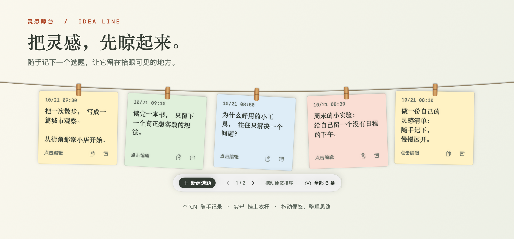
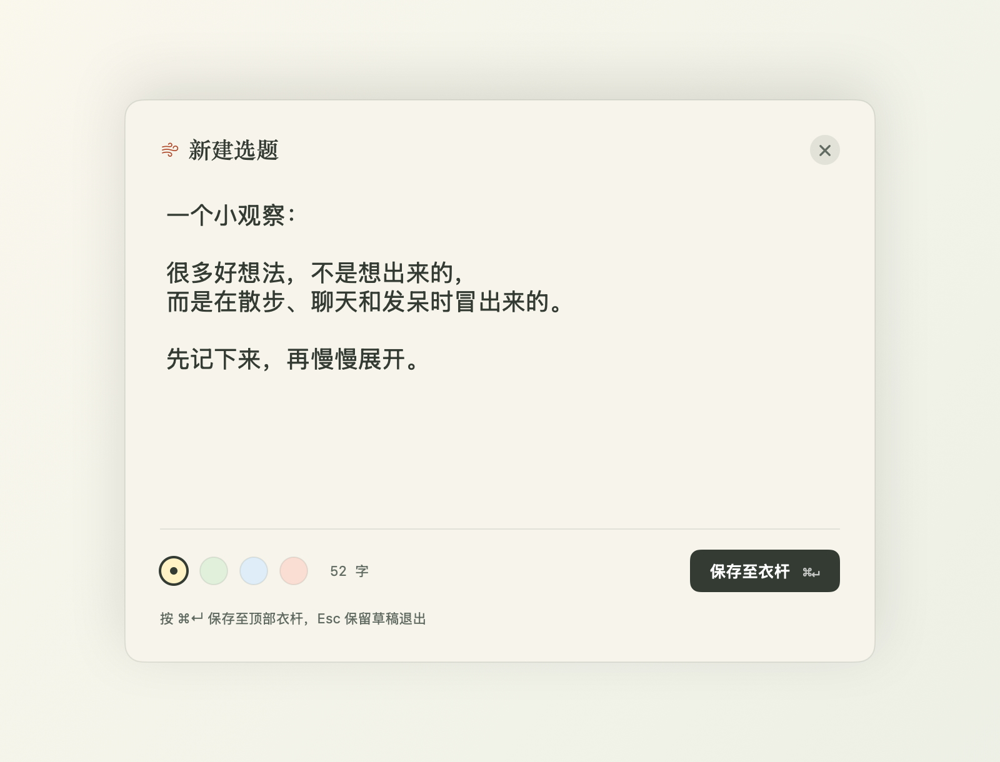
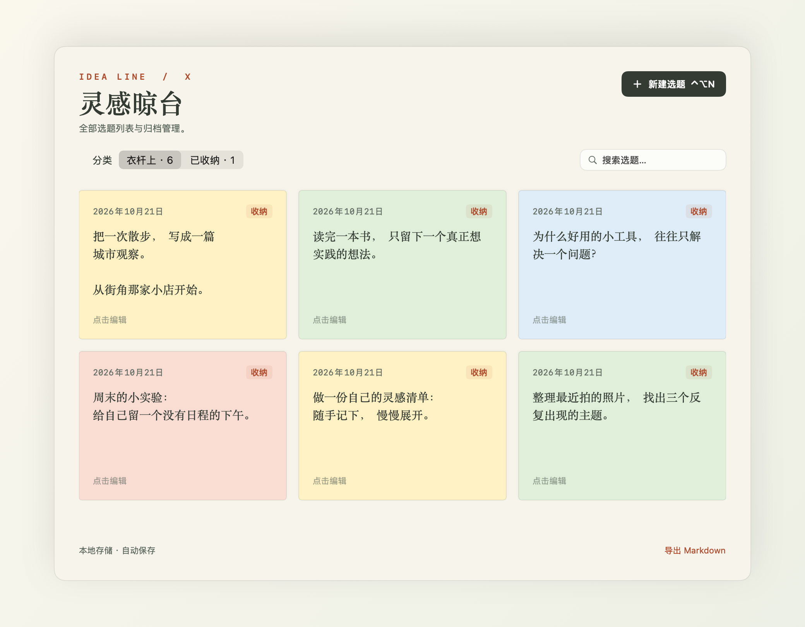

# 灵感晾台 · Idea Line

原生 macOS X 选题记录工具。使用快捷键呼出书写窗口，按 Cmd+Enter 将便签挂靠在屏幕边缘的衣杆上，可选择上下左右四个方位。



*演示图由应用真实界面组件渲染，内容均为示例选题，背景为展示用。*

项目仓库：[longhaiqwe/IdeaLine](https://github.com/longhaiqwe/IdeaLine)。[下载正式安装包](https://github.com/longhaiqwe/IdeaLine/releases/latest)：支持 Apple Silicon 与 Intel，要求 macOS 14 或更新版本。

## 界面预览

**随手记录**：按 `⌃⌥N` 打开书写窗口，选择便签颜色，按 `⌘↵` 保存至衣杆；按 Esc 可保留草稿并收起。



**集中整理**：在「全部选题」中搜索、继续编辑和收纳选题，也可以恢复已收纳内容或导出 Markdown。



## 使用

下载 Release 中的 `IdeaLine-v<版本号>-macOS-universal.zip`，解压后将「灵感晾台.app」拖入「应用程序」并打开，菜单栏会出现微风图标。正式安装包使用 Developer ID 签名并通过 Apple 公证，无需安装开发工具；GitHub 自动提供的 `Source code` 压缩包是源码，不是应用。自行构建时打开 `build/灵感晾台.app`。

Release 同时提供 `SHA256SUMS.txt`。将它和安装包放在同一目录，可运行 `shasum -a 256 -c SHA256SUMS.txt` 校验下载内容。

| 操作 | 快捷键 / 手势 |
| --- | --- |
| 打开书写窗口 | Control + Option + N |
| 保存至衣杆 | Command + Enter |
| 收起书写窗口并保留草稿 | Esc 或右上角关闭 |
| 展开 / 收起衣杆 | Control + Option + L |
| 临时查看衣杆 | 鼠标停在所选方位的屏幕边缘约 0.3 秒 |
| 固定展开 | 点击工具条右侧「固定」；再次点击恢复自动收起。重启保留，快捷键主动收起会解除固定 |
| 切换晾台位置 | 菜单栏 → 晾台位置 → 上方 / 下方 / 左侧 / 右侧 |
| 继续编辑 | 点击便签 |
| 调整便签顺序 | 按住单张便签沿排列方向拖动，松手后自动保存排序 |
| 浏览更多便签 | 左右侧使用滚轮或触控板连续滚动；上下方点击翻页箭头 |
| 复制 / 收纳 | 便签右下角按钮，或右键菜单 |
| 搜索、恢复已收纳选题、导出 | 菜单栏 → 全部选题 |

默认位于上方；上下两侧横排，左右两侧竖排，便签文字始终正向显示。位置选择自动保存，重启后保留。衣杆在鼠标移开后自动收起。左右侧的便签区域接收滚轮和触控板滚动（包括便签间隙）；上下方的空白区域允许鼠标点击穿透。按住单张便签沿排列方向拖动，可调整排列顺序（上下方限当前页内）；相邻便签会让出位置，松手后自动保存，重启后保留顺序。拖拽期间保持衣杆展开。左右侧连续展示全部便签，超出高度后滚动浏览；上下方超过单屏容量后使用箭头翻页，本地保存数量不受衣杆显示容量限制。提供四种纸张底色。收纳不会删除内容，可随时恢复挂起。

快捷键固定为 ⌃⌥N 和 ⌃⌥L；如果被其他程序占用，会显示提示，仍可使用菜单栏入口。应用退出后全局快捷键停止生效。若使用 Karabiner 将 Ctrl+N / Ctrl+L 映射成 Command 组合，规则需排除额外的 Option，避免拦截这两个全局快捷键。

## 数据

数据与未完成草稿保存到：

`~/Library/Application Support/IdeaLine/ideas.json`

选题与草稿纯本地保存，无账号、无 X 自动发布。配置更新源的发行版仅为检查和下载应用更新联网，不上传选题或草稿。菜单栏可打开数据文件夹。所有提交使用原子写入；写入失败时不关闭编辑器，不假报成功。读取损坏文件失败时保留原文件并禁止覆盖。建议定期导出 Markdown 或备份 JSON 文件。Markdown 导出包含已收纳内容，当前不支持 Markdown 导入。

已有未提交草稿时，点击其他便签会先打开草稿，避免丢失正在写的内容。

## 开发

需要 macOS 14+、Swift 5.9+（Xcode / Command Line Tools）和 Python 3。没有开发工具时先运行 `xcode-select --install`；可用 `swift --version` 和 `python3 --version` 检查环境。更新功能依赖 Sparkle 2.9.2，首次构建需要联网下载依赖。普通本机构建不需要 Apple Developer 账号、签名证书或公证凭据。

```sh
git clone https://github.com/longhaiqwe/IdeaLine.git
cd IdeaLine
swift test
python3 scripts/test_release_config.py
scripts/build-app.sh
open build/灵感晾台.app
```

构建产物使用本机架构、本地 ad-hoc 签名，适合这台 Mac 使用；没有 Apple 公证。构建脚本生成独立图标及 .app 包。

README 配图可在 macOS 上运行 `scripts/render-readme.sh` 重新生成，输出到 `docs/images/`。脚本直接使用现有 SwiftUI 组件和临时示例数据，不读取个人选题，不截图桌面，也不修改正在运行的应用。

## 应用更新

菜单栏提供「关于灵感晾台」「检查更新…」「自动检查更新」和「自动下载并安装更新」。后台发现新版时显示菜单栏提醒，点击后查看更新说明并安装。自动检查默认每天一次，自动下载安装默认关闭；关闭自动检查后，自动下载安装选项禁用。

`release.json` 已配置本仓库的更新清单地址和独立的 Sparkle 签名公钥。正式发行版通过 `appcast.xml` 获取新版、验证安装包签名并安装。旧的未配置开发包需要先手动安装一次正式版本。版本号、打包、公证和更新清单流程见 [发布文档](docs/releasing.md)。

- `Store.swift`：JSON 持久化、草稿、编辑与收纳。
- `Views.swift`：衣杆、纸条、书写窗口和全部选题。
- `AppDelegate.swift`：菜单栏、窗口、屏幕边缘触发和点击穿透。
- `HotKeys.swift`：Carbon 全局快捷键，不需要辅助功能权限。

测试覆盖创建、编辑、收纳、恢复、重启读取、草稿、损坏文件保护、写入失败和多条选题导出。多显示器、原生全屏 Space 与不同中文输入法的组合仍需在对应环境验证。

## 致谢

交互参考 [Alejandro Buján 的 Tendedero](https://github.com/alejandrobujan/tendedero)：顶部衣杆、悬挂卡片、透明面板和 Carbon 全局快捷键的实现方式。应用使用独立名称与自行绘制的图标，不使用原项目品牌素材。相关 MIT 许可保留于 `THIRD_PARTY_LICENSES.txt`，并随应用分发。
